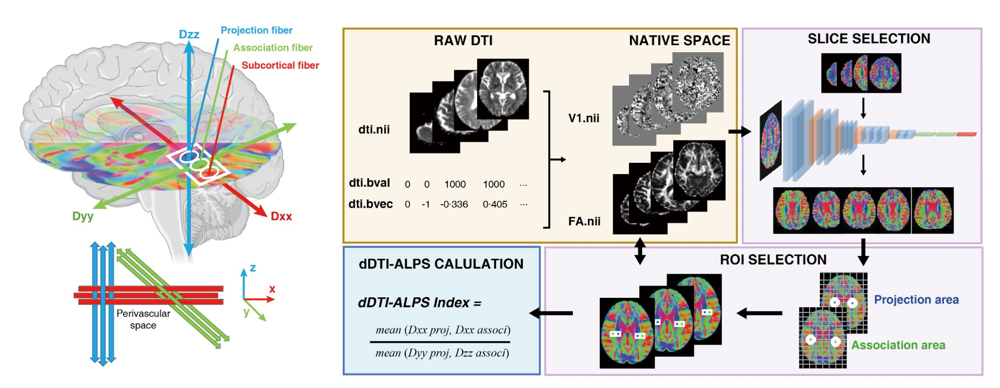

# dALPS (DTI-based ALPS index)



This repository provides a **native-space DTI** pipeline to compute the **(d)DTI-ALPS index** using a combination of:
- **V1 (principal eigenvector) slice rendering** (RGB),
- a **CNN-based slice quality filter**,
- **YOLOv5-based ROI detection**, and
- **FSL-based tensor-component statistics** within the detected ROIs.

---

## Citation (required)

If you use this toolkit in your research, please cite **the dALPS method paper** and the relevant dependencies below.

### dALPS method paper
- **Lin C.** et al. *Deep learning enhanced ALPS reveals genetic and environmental factors of brain glymphatic function.* **EBioMedicine** (2026). DOI: **10.1016/j.ebiom.2026.106133**

### Dependencies to cite (as applicable)
- **YOLO / object detection**
  - Ultralytics. *YOLOv5* (software). GitHub repository.
  - Redmon J., Divvala S., Girshick R., Farhadi A. *You Only Look Once: Unified, Real-Time Object Detection.* CVPR (2016).
- **FSL**
  - Smith S.M. et al. *Advances in functional and structural MR image analysis and implementation as FSL.* NeuroImage (2004).


---

## Contact

If you have questions or encounter issues while using this toolkit, you are welcome to contact the **first author** of the dALPS paper:

- **Cha Lin** — linch58@mail2.sysu.edu.cn

---

## Repository layout

```
dALPS/
  models/                      # place pretrained weights here (not tracked by git by default)
    dALPS_CNN.h5
    dALPS_YoloV5.pt
  scripts/
    dalps_nii2png.py           # Step 1: V1 -> per-slice RGB PNG
    dalps_dl.py                # Step 2: CNN slice QC + YOLO ROI + boundary CSV
    dalps_fsl_extract.sh       # Step 3: FSL ROI stats -> output.csv
    dalps_calculate_alps.py    # Step 4: aggregate -> ALPS.csv
  configs/
    example_config.yaml
  examples/
    id.txt
  legacy/                      # original scripts (for reference)
  work/                        # intermediate outputs (created at runtime)
  outputs/                     # final outputs (created at runtime)
```

---

## Input requirements (native space)

For each subject ID `<ID>` (e.g., `sub-001`), you need:

### 1) V1 file (for RGB slice rendering)
- `<ID>_V1.nii.gz`

### 2) Files for ROI-based tensor statistics (used by FSL step)
Under `subjects_root/<ID>/`, place:
- `<ID>_FA.nii.gz`
- `vol0000.nii.gz`
- `vol0003.nii.gz`
- `vol0005.nii.gz`

---

## Installation

### Python dependencies
```bash
pip install -r requirements.txt
```

> Install `tensorflow` / `torch` according to your CPU/GPU environment (official installation instructions are recommended).

### FSL
Step 3 requires FSL (`fslmaths`, `fslstats`) available in your `PATH`.

---

## Usage (recommended step-by-step)

### Step 0: Prepare the subject list
Create a text file with one subject ID per line (see `examples/id.txt`).

### Step 1: Convert V1 to per-slice RGB PNGs
```bash
python scripts/dalps_nii2png.py   --ids examples/id.txt   --v1-dir /path/to/native_space_v1_files   --out-dir work/png
```

Outputs: `work/png/<ID>_<slice>.png`

> By default this matches the legacy orientation behavior with `np.rot90(k=1)`. If your ROI mapping is shifted/rotated, verify orientation and adjust `--rotate-k90`.

### Step 2: CNN slice QC + YOLO ROI detection
```bash
python scripts/dalps_dl.py   --png-dir work/png   --work-dir work   --cnn-weights models/dALPS_CNN.h5   --yolo-weights models/dALPS_YoloV5.pt   --device cuda:0
```

Outputs:
- `work/predictions.csv` — CNN predictions
- `work/png_yes/` — slices kept by CNN
- `work/rect_images/` — cropped ROI patches (QC)
- `work/output_boundary_coordinates.csv` — ROI boundary coordinates for the FSL step

> If you prefer **not** to let `torch.hub` download YOLOv5 automatically, clone YOLOv5 locally and add `--yolov5-repo /path/to/yolov5`.

### Step 3: FSL ROI statistics (mean tensor components)
```bash
bash scripts/dalps_fsl_extract.sh   --boundary_csv work/output_boundary_coordinates.csv   --subjects_root /path/to/subjects_root   --out_csv outputs/output.csv
```

Output: `outputs/output.csv` (per-slice values `value1..value8`)

### Step 4: Compute ALPS per slice and aggregate per subject
```bash
python scripts/dalps_calculate_alps.py   --input-csv outputs/output.csv   --out-subject-csv outputs/ALPS.csv   --out-slice-csv outputs/output_with_alps.csv
```

Outputs:
- `outputs/ALPS.csv` — **final** ALPS per subject
- `outputs/output_with_alps.csv` — optional per-slice ALPS (right/left)

---

## How ALPS is computed (legacy-compatible)

From Step 3 we obtain `value1..value8`. Step 4 computes:
- `ALPS_right = (value1 + value2) / (value3 + value4)`
- `ALPS_left  = (value5 + value6) / (value7 + value8)`

Aggregation per subject:
- If both sides exist (non-zero), final = mean(right, left)
- If only one side exists, final = that side
- If neither exists, final = 0

